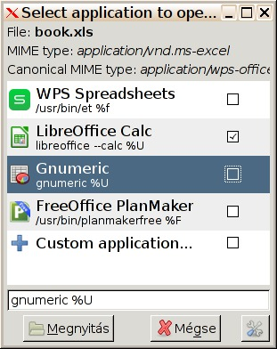

# mimeopen-gui
Graphical "Open with..." application chooser for Freedesktop compatible environments

## Screenshots

## Usage

- `mimeopen-gui [<FILE> | <URL>]` shows a list of applications in a normal Gtk2 window which claim to be able to open the given file or URL.
- default apps are sorted to the top
- the first column of checkboxes is your own setting (`$XDG_CONFIG_HOME/mimeapps.list`): tick an application's row to make it a default opener. Multiple default apps are allowed.
- the second column of checkboxes shows the system-wide settings (`$XDG_CONFIG_DIRS`, `$XDG_DATA_DIRS`). It is changeable only if you can write the file. Hover over a checkbox to see the file where the setting comes from.
- when the files to open have only one MIME type, drag and drop the rows to reorder them: the upper a ticked application is, the more preferred it is in your `mimeapps.list`. Unticking all applications removes the MIME type from it. Entries of not installed applications are kept.
- only the `[Default Applications]` section of the `mimeapps.list` files is read and written, `[Added Associations]` and the others are left alone.

# Project issues, bugs, feature requests, ideas

1. clone the repo
2. use [git-bug](https://github.com/git-bug/git-bug) to open a new ticket in this repo
3. find one or more person in the commit history to make contact with, then either

   a. send the URL of your git clone to the other contributor(s), via E-mail or other channel, 
   requesting them to pull (`git-bug` issues and/or branches as well) from you.
   This is the preferred way, since it's easier to update your ticket, amend changes, and/or contibute later on.
   
   b. or, if you don't provide your repo's location, send your newly created `git-bug` ticket (or patch if you already propose a code change) via E-mail.
